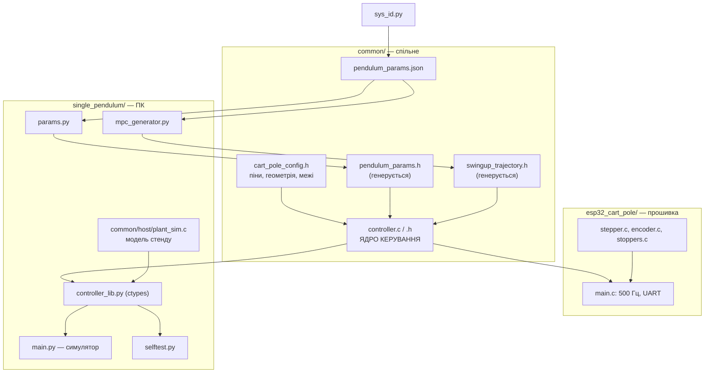
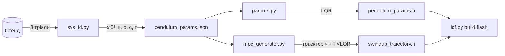

# 02 — Архітектура коду

## Головний принцип: один код керування для заліза і симуляції



Ядро [`common/controller.c`](../common/controller.c) **не знає**, на чому воно
працює. На вхід йому дають сирі виміри (тіки енкодера, положення візка,
стан стоперів, команди), на виході воно повертає швидкість для двигуна і
події для журналу.

- На ESP32 його викликає [`esp32_cart_pole/main/main.c`](../esp32_cart_pole/main/main.c).
- На ПК його викликає Python через [`controller_lib.py`](../single_pendulum/controller_lib.py),
  а замість заліза підставляється модель [`common/host/plant_sim.c`](../common/host/plant_sim.c).

Тому симуляція — не «схожа» програма, а **та сама прошивка** на моделі стенду.

## Карта репозиторію

| Шлях | Що це |
|---|---|
| `common/cart_pole_config.h` | **Ручні** налаштування: піни, рейка, межі, пороги, частоти |
| `common/pendulum_params.json` | **Виміряні** параметри маятника + ваги LQR (пише `sys_id.py`) |
| `common/pendulum_params.h` | Ті самі параметри + готові коефіцієнти LQR для C. **Генерується**, не редагувати |
| `common/swingup_trajectory.h` | Траєкторія підйому + коефіцієнти TVLQR. **Генерується**, не редагувати |
| `common/controller.c/.h` | Ядро: стани, оцінювач кута, регулятори, безпека, SysID-профілі |
| `common/host/` | Тільки для ПК: C API для Python і модель стенду |
| `esp32_cart_pole/main/` | Прошивка: обгортка над ядром + драйвери |
| `esp32_step_calibration/` | Окрема прошивка: вимірює `STEPS_PER_METER` |
| `esp32_hardware_test/` | Окрема прошивка: перевірка вузлів стенду |
| `single_pendulum/` | Симулятор, генератор траєкторії, автотест, віртуальний стенд |
| `sys_id.py` | Ідентифікація параметрів зі стенду |
| `cli_control.py` | Панель керування стендом у терміналі |
| `sysid_data/` | Сирі записи SysID (`.npz`) |
| `hybrid_mpc_lqr/`, `mpc_sim/` | Подвійний маятник — старий код з умовними параметрами, поки не чіпали |

## Звідки беруться параметри



`sys_id.py` робить увесь ланцюжок сам: підбирає параметри → оновлює JSON →
перегенеровує обидва заголовки → проганяє автотест → (з `--flash`) прошиває.

Python ніколи не дублює числа з C вручну:
[`hwconfig.py`](../single_pendulum/hwconfig.py) читає `#define` з
`cart_pole_config.h` і номери станів/подій з `controller.h`.

## Прошивка: що відбувається щотакту

[`main.c`](../esp32_cart_pole/main/main.c) запускає дві задачі FreeRTOS на різних ядрах:

| Задача | Ядро | Частота | Що робить |
|---|---|---|---|
| `control_task` | 1 | 500 Гц, найвищий пріоритет | датчики → `ctrl_step()` → двигун. **Нічого не друкує** |
| `io_task` | 0 | 50 Гц | команди з UART, друк подій, телеметрія 10 Гц, вивантаження SysID |

Один такт `control_task` (кожні 2 мс):

```
1. stoppers_update()               дебаунс кінцевиків
2. encoder_get_count()             тіки маятника
3. stepper_get_position_m()        X з лічильника виданих кроків
4. забрати команди (s/x/h/c/i)
5. ctrl_step()                     ← ядро: все рішення тут
6. stepper_set_velocity(v)         нова частота кроків
7. події → черга, зразки SysID → буфер у RAM
```

Чому друк винесено в окрему задачу: рядок на 115200 бод друкується ~12 мс.
Раніше `printf` стояв у контурі керування і «заморожував» його саме в
критичні моменти (наприклад, при захопленні вгорі).

## Драйвери прошивки

| Файл | Що робить |
|---|---|
| [`stepper.c`](../esp32_cart_pole/main/stepper.c) | LEDC генерує кроки, PCNT рахує їх. Самоперевірка: якщо PCNT не бачить кроків, переходить на розрахункову позицію і пише `(!PCNT)` |
| [`encoder.c`](../esp32_cart_pole/main/encoder.c) | PCNT ×4, фільтр завад 10 мкс, накопичення переповнень (watch point на ±30000) |
| [`stoppers.c`](../esp32_cart_pole/main/stoppers.c) | дебаунс: стан змінюється лише після 4 однакових вибірок поспіль (8 мс) |

## Python-частина

| Файл | Що робить |
|---|---|
| [`controller_lib.py`](../single_pendulum/controller_lib.py) | збирає C у `.so` (gcc), класи `Controller`, `Plant`, `Bench` (= контролер + модель) |
| [`params.py`](../single_pendulum/params.py) | читає/пише JSON, рахує LQR, генерує `pendulum_params.h` |
| [`mpc_generator.py`](../single_pendulum/mpc_generator.py) | оптимізує траєкторію підйому, рахує TVLQR, генерує `swingup_trajectory.h` |
| [`simulation_manager.py`](../single_pendulum/simulation_manager.py) + [`main.py`](../single_pendulum/main.py) | інтерактивний симулятор (Pygame) |
| [`selftest.py`](../single_pendulum/selftest.py) | автоперевірка прошивки на 9 варіантах моделі |
| [`virtual_stand.py`](../single_pendulum/virtual_stand.py) | «стенд» на віртуальному COM-порті |
