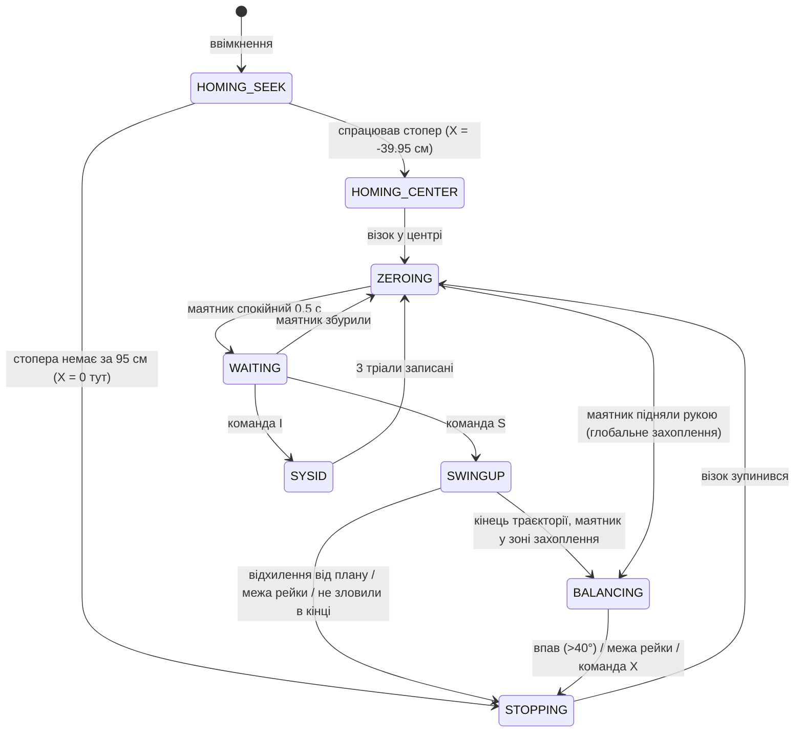
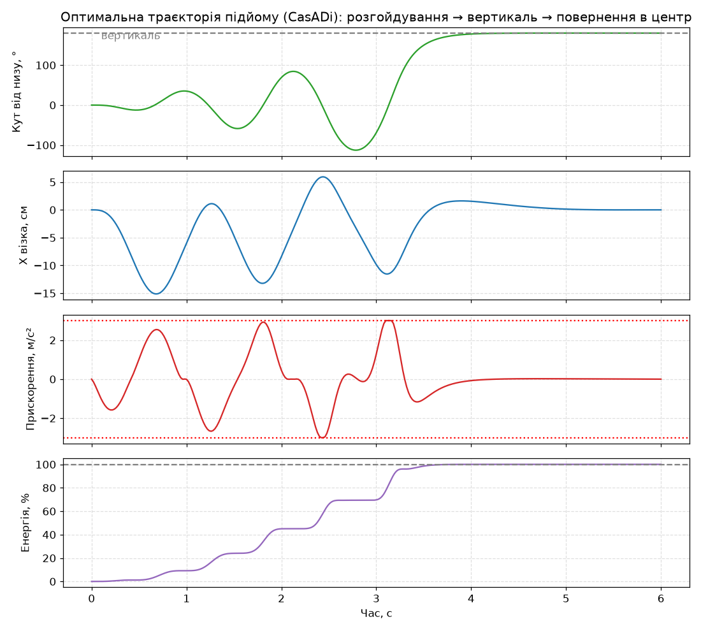
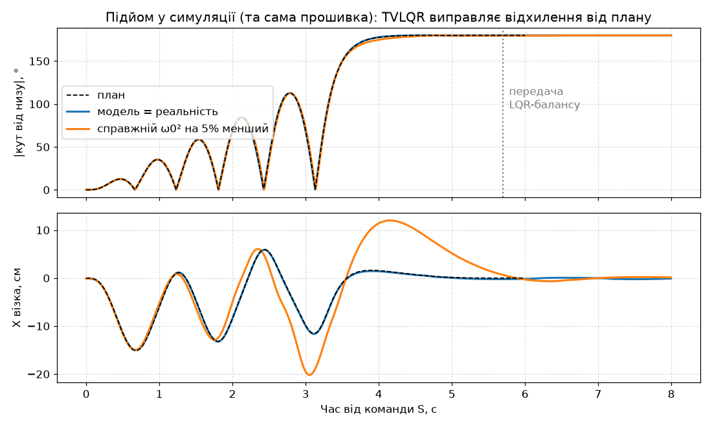

# 04 — Керування

> Формули, матриця K, полюси, запаси стійкості й аналіз оцінювача — у [12 — Математика](12-math.md).

Усе в цьому розділі — функція `ctrl_step()` у [`common/controller.c`](../common/controller.c),
яка викликається кожні 2 мс.

## Автомат станів



| Стан | Назва в телеметрії | Що робить |
|---|---|---|
| `HOMING_SEEK` | ПОШУК НУЛЯ | їде вліво 5 см/с до стопера |
| `HOMING_CENTER` | ВИЇЗД У ЦЕНТР | їде в X = 0 (до 12 см/с) |
| `ZEROING` | ЗАНУЛЕННЯ ВНИЗУ | гасить коливання і повертає візок у центр |
| `WAITING` | ОЧІКУЄ 's' | тримає візок у центрі, чекає команду |
| `SWINGUP` | ПІДЙОМ | веде маятник угору за траєкторією |
| `BALANCING` | БАЛАНС | тримає маятник вертикально (LQR) |
| `STOPPING` | ЗУПИНКА | плавно гальмує до нуля |
| `SYSID` | SYSID | 3 тестові рухи для ідентифікації |

Також у будь-який момент:
- **H** → новий хомінг; **X** або пробіл → `STOPPING`;
- **C** (у `ZEROING`/`WAITING`) → прийняти поточне місце за X = 0;
- **S** та **I** приймаються в `WAITING`, або в `ZEROING` «в чергу» (до 15 с), поки маятник заспокоїться.

## Порядок дій в одному такті

1. **Оцінювач**: з тіків енкодера → кут θ, φ і кутова швидкість ω.
2. **Стопери**: якщо щойно спрацював — X точно відомий (±39.95 см), перекалібрувати.
3. **Команди** з UART.
4. **Глобальне захоплення**: якщо маятник раптом опинився вгорі — увімкнути баланс.
5. **Регулятор поточного стану** → бажане прискорення або швидкість.
6. **Безпека**: обмеження швидкості гальмівним шляхом, стопери, межі.
7. **Обмеження прискорення** → нова швидкість для двигуна.
8. Запис SysID, **автокорекція нуля енкодера**.

---

## Вимірювання

### Положення візка
`X = (кроки, видані двигуну) / STEPS_PER_METER + зсув калібрування`.
Кроки рахує апаратний PCNT безпосередньо з піна STEP. Зсув калібрування
змінюється **лише** в трьох випадках: спрацював стопер, хомінг не знайшов стопер,
команда `C`.

При кожному спрацюванні стопера прошивка друкує, наскільки X «з'їхав» до цього
моменту (`корекція X ... мм`). Якщо це помітно більше міліметра — губляться кроки.

### Кут і кутова швидкість — оцінювач з моделлю
Енкодер дає кут з кроком 0.15°. Швидкість простою різницею на 500 Гц дуже
шумна (крок 0.15° за 2 мс = 1.3 рад/с!). Тому використовується **оцінювач**:

```
прогноз:  кут ← кут + ω·dt + ½·α·dt²,   ω ← ω + α·dt
          де α = −ω0²·sin φ − γ·a·cos φ − d·ω   (модель + відоме прискорення візка)
корекція: r = виміряний кут − прогноз
          кут ← прогноз + 0.27·r,   ω ← ω + (0.021/dt)·r
```

Модель передбачає рух, енкодер лише виправляє помилки моделі. Без моделі
(простий альфа-бета фільтр) ω запізнювалась на ~25 мс, і цього вистачало, щоб
зірвати підйом. Оцінювач працює на **нерозгорнутому** куті (без стрибків ±180°).

### Автокорекція нуля енкодера
Енкодер відносний: «нуль» — це положення в момент ввімкнення. Якщо маятник
тоді хитався або енкодер пропустив імпульси — «низ» буде зсунутий (звідси
старий баг «низ = 60°»).

Правило: **якщо маятник нерухомий 1 с і візок стоїть — маятник висить точно
внизу** (так діє гравітація). Прошивка бере середину коливань за цю секунду як
новий нуль. Працює в `ZEROING`, `WAITING` і між тріалами SysID; якщо
корекція більша за 0.45°, друкується подія `Нуль енкодера скориговано на ...`.

---

## Гасіння коливань внизу

З [03](03-model.md): `dE/dt = −γ·a·cos φ·ω`. Обираємо прискорення візка

```
a = K · ω · cos φ          K = DOWN_K_DAMP = 1.11
```

Тоді dE/dt = −γ·K·(ω·cos φ)² ≤ 0 — енергія **завжди** зменшується, навіть
якщо маятник крутиться повними обертами. Біля низу це дає затухання з
відносним коефіцієнтом ζ = 0.35 (`K = 2·ζ·ω0/γ`).

До цього додається м'яке центрування візка: `− 4·x − 4·v`. Обмеження:
|a| ≤ 4.5 м/с², |v| ≤ 0.35 м/с, |x| ≤ 20 см.

«Спокій» (перехід у `WAITING`): |φ| < 2.5°, |ω| < 0.1 рад/с, |x| < 1 см,
візок стоїть — протягом 0.5 с.

> Старий закон був `v = −k·ω`. Він пропорційний **швидкості**, а не
> прискоренню — і на ділі лише змінює частоту коливань, майже не забираючи
> енергію.

---

## Підйом: траєкторія + TVLQR

Це **не** онлайн-MPC (оптимізація щотакту на ESP32 була б надто повільною).
Схема з двох частин:

### 1. Оптимальна траєкторія (заздалегідь, на ПК)
[`mpc_generator.py`](../single_pendulum/mpc_generator.py) розв'язує задачу оптимізації
(CasADi + IPOPT, метод прямої колокації):

- **знайти** рух візка x(t) на 6 с;
- **щоб** маятник почав висячи (θ = π) і закінчив вертикально (θ = 0, ω = 0) з візком у центрі;
- **за обмежень** |x| ≤ 22 см, |v| ≤ 0.4 м/с, |a| ≤ 3 м/с², |ривок| ≤ 40 м/с³;
- **мінімізуючи** ∫(a² + 0.002·ривок² + 20·x²) dt — тобто якомога м'якше і ближче до центру.

Оптимізатор сам «винаходить» розгойдування: за кожне півколивання енергія
маятника зростає, доки не вистачить, щоб піднятися:

| Час | Розмах від низу | Енергія (0% висить, 100% вгорі) |
|---|---|---|
| 0.47 с | 13° | 1% |
| 0.97 с | 35° | 9% |
| 1.53 с | 59° | 24% |
| 2.12 с | 84° | 45% |
| 2.78 с | 113° | 69% |
| 3.85 с | вертикаль | 100% |

Після 3.85 с маятник уже вгорі, а траєкторія ще ~2 с плавно повертає візок у центр.



Енергія росте «сходинками»: кожне півколивання візок підкачує її, а між
підкачуваннями маятник летить вільно.

### 2. TVLQR — зворотний зв'язок уздовж траєкторії
Реальний маятник ніколи не повторить план ідеально. Тому на кожному кроці
траєкторії заздалегідь пораховано 4 коефіцієнти K(t) («LQR, що змінюється в
часі»). На стенді:

```
a = a_план(t) − K(t) · [x − x_план,  θ − θ_план,  v − v_план,  ω − ω_план]
```

Траєкторія і K(t) записані з кроком 10 мс у
[`swingup_trajectory.h`](../common/swingup_trajectory.h) (601 точка),
між точками — лінійна інтерполяція.

Підйом **скасовується**, якщо візок дійшов до ±35 см або кут відхилився від
плану більш ніж на 57°. Передача балансу — лише в останні 5% траєкторії
(раніше маятник може проходити зону захоплення на краю рейки, і LQR не встигне).

Перевірено: підйом проходить, навіть якщо реальний ω0² відрізняється від
виміряного на −8…+12%.



Помаранчева лінія — «справжній» маятник на 5% повільніший, ніж думає модель.
Кут усе одно йде точно за планом: TVLQR компенсує різницю додатковим рухом
візка (до −20 см замість −12). Без зворотного зв'язку такий маятник просто не
дійшов би до верху.

---

## Баланс: LQR

### Ідея
Стан системи — 5 чисел: `s = [x, θ, v, ω, ∫x dt]`. Регулятор лінійний:

```
a = −(K_x·x + K_θ·θ + K_v·v + K_ω·ω + K_I·∫x)
K = [−14.8,  50.1,  −11.4,  8.5,  −6.2]
```

Прискорення інтегрується в швидкість для двигуна: `v ← v + a·dt`.

**LQR** (Linear-Quadratic Regulator) — спосіб *розрахувати* K, а не підбирати
вручну. Задаєш, наскільки «погано» кожне відхилення (матриця Q) і наскільки
«дорого» прискорення (R); рівняння Ріккаті дає K, що мінімізує
∫(sᵀQs + R·a²) dt. У нас Q = diag(40, 80, 6, 2, 20), R = 0.5
(файл [`pendulum_params.json`](../common/pendulum_params.json)).

### Що означає кожен коефіцієнт
- **K_θ = 50** — маятник нахилився на 1° (0.017 рад) → візок прискорюється на
  0.87 м/с², щоб «підбігти» під нього.
- **K_ω = 8.5** — демпфер: гасить швидкість падіння, без нього маятник розгойдувався б.
- **K_x, K_v від'ємні** — це не помилка. Щоб поїхати *вправо* до центру, візок
  спершу мусить нахилити маятник *вправо*, а для цього — коротко смикнутися
  *вліво*. Система «немінімально-фазова», і LQR це враховує сам.
- **K_I** — інтеграл похибки X: якщо нуль енкодера неточний на частку градуса,
  без інтегратора візок «відповзав» би вбік. Обмежений ±0.3 м·с.

Для порівняння: старий вручну підібраний каскадний регулятор мав еквівалентні
K_θ ≈ 55, K_ω ≈ 8.5, K_x ≈ −16.5 — майже те саме, що дає LQR. Тепер ці числа
пораховані з моделі і перераховуються автоматично після SysID.

### Межі
|a| ≤ 7.5 м/с², |v| ≤ 0.7 м/с, |x| ≤ 34 см. Падіння — |θ| > 40°.

### Глобальне захоплення
У `ZEROING`, `WAITING`, `STOPPING` (і в кінці підйому): якщо |θ| < 28°,
|ω| < 3.5 рад/с і |x| < 20 см — одразу вмикається баланс. Можна підняти
маятник рукою — стенд підхопить. Після виходу з балансу захоплення
«заблоковане», доки маятник справді не впаде (|θ| > 57°): інакше команда «стоп»
одразу ж скасовувалась би.

---

## Безпека руху

1. **Обмеження прискорення в кожному стані** — жодних миттєвих стрибків
   швидкості (кроковий двигун від них губить кроки):

   | Стан | Макс. прискорення |
   |---|---|
   | Хомінг | 0.5 м/с² |
   | Виїзд у центр | 0.8 м/с² |
   | Гасіння | 4.5 м/с² |
   | Зупинка | 5 м/с² |
   | Підйом | 6 м/с² |
   | Баланс | 7.5 м/с² |

2. **Швидкість обмежена гальмівним шляхом** до межі рейки:
   `|v| ≤ √(2 · 0.8·a_max · відстань_до_межі)`. Візок завжди встигає зупинитися
   плавно, тож аварійна зупинка не потрібна.
3. **Стопери**: після дебаунсу (8 мс). Миттєва зупинка — лише при фізичному
   контакті, коли візок і так упирається.
4. **Межа частоти кроків** 36 кГц.
