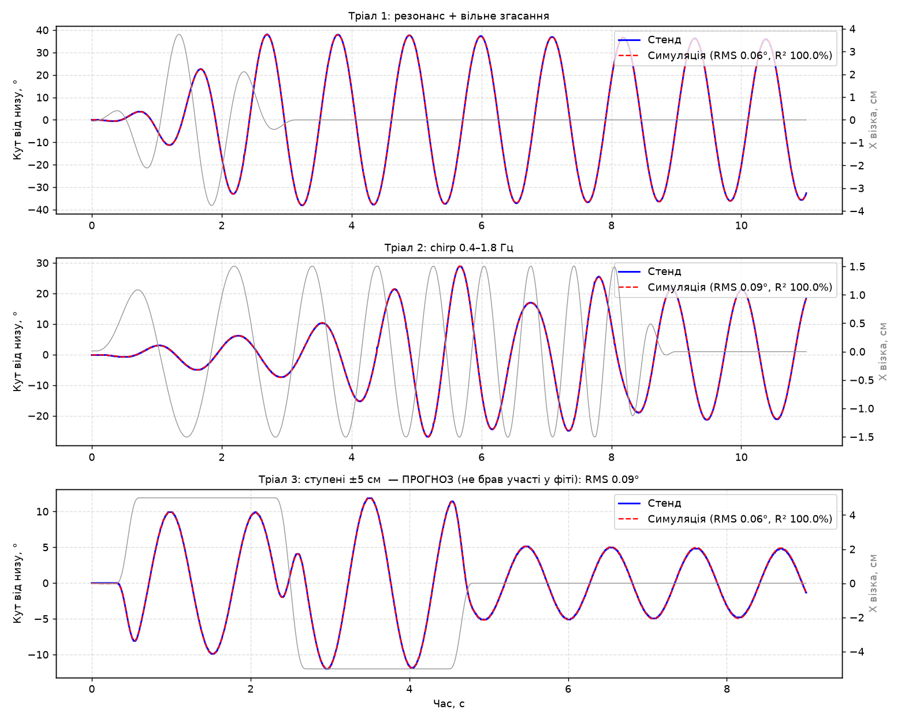

# 05 — SysID: як симуляція стала збігатися зі стендом

**SysID** (system identification, ідентифікація системи) — вимірювання
параметрів моделі на реальному об'єкті. Ідея проста: дати стенду відомий рух
і підібрати параметри, при яких симуляція повторює те, що зняв енкодер.

## Що вимірюється

5 параметрів моделі з [03](03-model.md): ω0², κ, d, c, τ. Плюс для кожного тріалу
окремо — зсув нуля енкодера і початковий стан (щоб неточний нуль не псував фіт).

## Три тріали

Стенд виконує їх сам, руками нічого не чіпати. Рух візка — заздалегідь задані
гладкі профілі ([`ctrl_sysid_profile`](../common/controller.c)), що починаються і
закінчуються в центрі з нульовою швидкістю.

| # | Профіль | Тривалість | Що «бачить» фіт |
|---|---|---|---|
| 1 | 3 періоди розгойдування ±4 см на власній частоті, потім візок **нерухомий** | 11 с | частота ω0, тертя d і c (по згасанню з ~38°) |
| 2 | Chirp: синус ±1.5 см, частота плавно росте 0.4 → 1.8 Гц | 11 с | реакція на різні частоти → κ, τ |
| 3 | Переїзди 0 → +5 → −5 → 0 см | 9 с | **перевірка**: не бере участі в першому фіті |

Між тріалами стенд сам гасить коливання (не довше 25 с).

## Запис без втрат

Дані пишуться в RAM ESP32 на 250 Гц (позиція з лічильника кроків, командна
швидкість, тіки енкодера) і вивантажуються по UART **після** тріалу.
Кожен рядок має номер — пропуски видно. Якщо втрачено > 2% — тріал відкидається.

## Фіт

[`sys_id.py`](../sys_id.py):

1. Початкове наближення: ω0 — з перетинів нуля у вільному згасанні тріалу 1,
   d — з логарифмічного декременту.
2. Метод найменших квадратів (`scipy.optimize.least_squares`): мінімізувати
   різницю «кут у симуляції − кут на стенді» по всіх точках. Симуляція — на C
   ([`plant_simulate`](../common/host/plant_sim.c)), тож весь фіт триває секунди.
3. **Перевірка**: фіт лише на тріалах 1+2, прогноз тріалу 3 → його похибка
   показує, чи модель справді описує стенд, а не просто «підігнана».
4. Фінальний фіт на всіх трьох.
5. Якщо похибка > 3° — параметри **не зберігаються** (захист від поганого запису).
6. Оновлення JSON → `pendulum_params.h` → траєкторія підйому → автотест → (з `--flash`) прошивка.

## Результат на стенді (15.11)



Синя лінія — стенд, червона пунктирна — симуляція; сіра — положення візка.

| | Тріал 1 | Тріал 2 | Тріал 3 (прогноз) |
|---|---|---|---|
| Похибка (СКВ) | 0.06° | 0.09° | **0.09°** |

Для масштабу: один крок енкодера — 0.15°, тобто симуляція збігається зі
стендом **точніше, ніж міряє енкодер**. Прогноз тріалу 3, який фіт не бачив,
такий самий точний — модель описує стенд, а не лише запам'ятала дані.

Для порівняння, старий SysID давав R² 83%, 87% і 50% (див. [08](08-history.md)).

### Виміряні параметри

| Параметр | Значення | ± σ |
|---|---|---|
| ω0² | 34.498 | 0.0003 |
| κ | 1.0545 | 0.0001 |
| d | 0.0139 1/с | 0.0001 |
| c | 0.0055 рад/с² | 0.0002 |
| τ | 2.4 мс | 0.02 мс |

### Що каже κ = 1.054
Візок реально проходить на 5.4% більше, ніж рахує прошивка. Тобто
`STEPS_PER_METER` завищений на 5.4%: 52.7 / 1.054 = **50.0 кроків/мм**. Саме таке
кругле число дає типова механіка (наприклад, мікрокрок 1/8 + шків GT2 на 16 зубів).
Найімовірніше, неточно виміряна відстань між стоперами або ширина візка
(реальний хід ≈ 84.2 см замість 79.9).

На керування це не впливає — κ входить у модель, і LQR та траєкторія вже
пораховані з урахуванням. Але це гарний приклад, як SysID знаходить
похибки калібрування, про які ніхто не підозрював.

## Як читати графік, якщо щось не так

| Що видно | Що це означає |
|---|---|
| Червона лінія поступово «відстає» по фазі | неточна ω0 (фіт не зійшовся) |
| Амплітуди збігаються на початку, а потім ні | неправильне тертя |
| Синя лінія має сходинки або зламаний відрізок | енкодер губить імпульси або пропуски в записі |
| κ далеко від 1 (< 0.9 або > 1.1) | губляться кроки / прослизає пас / неправильний `STEPS_PER_METER` |

## Коли запускати знову
Після будь-якої зміни механіки: інший вантаж, довжина стрижня, підшипник,
пас, мікрокрок, рейка. Підйом розрахований під конкретний період гойдань і
витримує похибку ω0² лише −8…+12%.

```bash
./venv/bin/python sys_id.py --port /dev/ttyUSB0 --flash
./venv/bin/python sys_id.py --file sysid_data/<файл>.npz --no-save   # перефітити старий запис
./venv/bin/python sys_id.py --simulate                               # перевірити сам фітер на синтетиці
```
