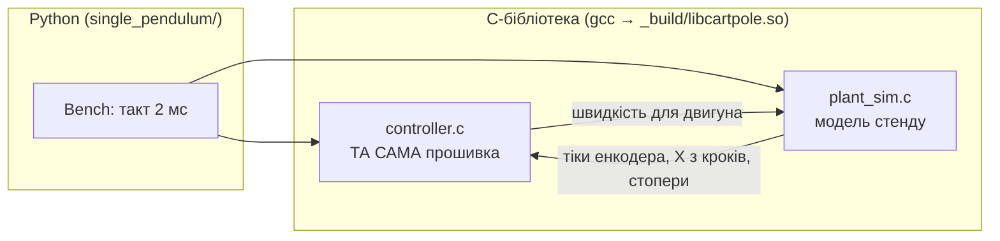

# 06 — Симуляція і тести

## Цифровий двійник



Модель стенду [`plant_sim.c`](../common/host/plant_sim.c) відтворює не лише
фізику маятника, а й «недоліки» заліза — щоб прошивка в симуляції стикалась з
тим самим, що й на стенді:

| Що моделюється | Як |
|---|---|
| Маятник | рівняння з [03](03-model.md), RK4 з дрібним кроком |
| Генератор кроків | мертва зона < 100 Гц, ціла частота кроків |
| Привід | запізнення τ |
| Енкодер | квантування 0.15°, довільний нуль при старті |
| Позиція візка | лічильник кроків, як на ESP32 |
| Стопери | дебаунс 4 вибірки; за стопером — стінка, кроки «губляться» |
| Люфт паса | опційно: вал крутиться, візок стоїть, доки не вибрано зазор |

Бібліотека збирається автоматично при першому імпорті `controller_lib.py`
(потрібен лише `gcc`) і перезбирається, якщо змінився будь-який C-файл.

## Інтерактивний симулятор

```bash
./venv/bin/python sim_pygame.py
```

| Клавіша | Дія |
|---|---|
| S | підйом |
| X / пробіл | стоп |
| H / C / I | хомінг / центр тут / SysID |
| ← → | поштовх маятника (0.8 рад/с) |
| M | розбіжність моделі: «справжній» ω0² ×0.95 або ×1.05 |
| R | перезапуск стенду |

Повзунки внизу змінюють коефіцієнти LQR наживо — зручно показати, що буде,
якщо K_θ замалий (маятник падає) або K_ω нульовий (розгойдується).

На екрані: справжнє положення візка (заливка) і те, що «думає» прошивка
(рамка), рейка зі стоперами і межами, телеметрія, журнал подій — ті самі
повідомлення, що друкує стенд.

## Автотест

```bash
./venv/bin/python single_pendulum/selftest.py      # 9 варіантів, ~3 с
./venv/bin/python single_pendulum/selftest.py -v --quick   # номінал + журнал подій
```

Сценарій для кожного варіанта:

1. Старт з візком **не** в центрі → хомінг → гасіння → `ОЧІКУЄ 's'`.
2. Підйом → 6 с балансу.
3. Поштовх маятника 1.2 рад/с — має втримати.
4. Команда «стоп» → маятник падає → гасіння до спокою.
5. Нуль енкодера штучно збивається на 60° → має сам виправитись.
6. Перевірка: стопери жодного разу не торкнулися, оцінка X збігається з реальною.
7. SysID (лише для номіналу).

Варіанти — модель стенду навмисно відрізняється від тієї, під яку пораховано
керування:

| Варіант | Що імітує |
|---|---|
| номінал | модель = реальність |
| ω0² −7% / +10% | інший вантаж або неточний SysID |
| κ 0.85 / 1.15 | візок проходить на 15% менше/більше за команду |
| τ 12 мс | розтягнутий пас, повільний привід |
| сухе тертя 0.4 | тугий підшипник |
| в'язке тертя ×3 | |
| люфт паса 1 мм | |

Метрики в рядку результату:

| Поле | Значення (номінал) | Що це |
|---|---|---|
| `swingup_s` | 5.71 с | від команди S до балансу |
| `bal_x_rms_mm` / `bal_th_rms_deg` | 1.1 мм / 0.07° | наскільки рівно стоїть |
| `max_x_after_kick_mm` | ~170 мм | хід візка після поштовху (межа 340) |
| `zeroing_after_fall_s` | ~12 с | від падіння до спокою |
| `zero_fix_s` | ~9 с | виправлення збитого на 60° нуля |
| `x_estimate_err_mm` | 0.35 мм | X прошивки проти справжнього |

## Межі робастності (перевірено)

| Що | Витримує |
|---|---|
| Похибка ω0² (підйом) | −8 … +12% |
| κ, τ, тертя, люфт | усі варіанти з таблиці вище |
| Поштовх маятника (баланс) | до ~1.5 рад/с (≈0.5 м/с на кінці стрижня) |

Найслабше місце — **ω0**: траєкторія розрахована під конкретний період
гойдань. Тому після зміни маятника спершу SysID.

## Віртуальний стенд

```bash
./venv/bin/python single_pendulum/virtual_stand.py --speed 4
# друкує: Віртуальний стенд: /dev/pts/3
./venv/bin/python cli_control.py --port /dev/pts/3
./venv/bin/python sys_id.py --port /dev/pts/3 --no-save
```

Створює віртуальний COM-порт і говорить точно тим самим протоколом, що
ESP32. Так перевірялись `cli_control.py` і `sys_id.py` повністю, без плати.
`--speed 4` — прискорити час, `--omega-scale 0.95` — розбіжність моделі.
