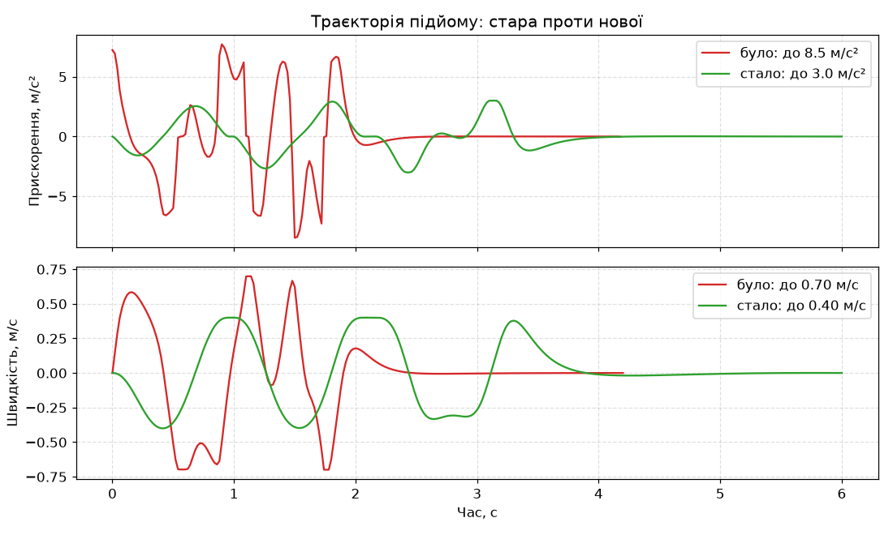

# 08 — Що було і що змінили

Перша версія (коміти до `0d0d694 swing up`) уже вміла балансувати, але мала
низку проблем на стенді. Нижче — що спостерігали, яка була справжня причина в
коді і що зроблено.

## Проблеми зі стенду

| Що бачили | Справжня причина | Рішення |
|---|---|---|
| **Погано працює занулення** (коливання внизу довго не гаснуть) | закон `v = −k·ω` задавав *швидкість*, пропорційну ω. Фізично це змінює частоту коливань, але майже не забирає енергію | енергетичний закон `a = K·ω·cos φ`: енергія спадає завжди, навіть при обертах |
| **MPC занадто швидко розганяє** | траєкторія до 8.5 м/с², ривок ~360 м/с³, 0.7 м/с; прошивка програвала її без обмежень і без зворотного зв'язку по маятнику | нова траєкторія ≤ 3 м/с², ривок ≤ 40 м/с³, ≤ 0.4 м/с + TVLQR |
| **Після маневру низ = 60°** | `encoder_reset()` викликався, коли маятник ще хитався (таймаут SysID, хомінг, команда `c`); лічильник PCNT губив переповнення (не було watch point) | нуль — лише при старті + автокорекція в спокої; watch point на ±30000 |
| **З'їжджає центр рейки** | X рахувався як інтеграл *команди*, а не реальних кроків; у кількох місцях `cart_x = 0` «де стоїмо»; різкі зупинки з 0.7 м/с → пропуски кроків | X з апаратного лічильника виданих кроків; X переписується лише стопером; усі зупинки плавні |
| **Не їде вліво** | найімовірніше: сирий (без дебаунсу) сигнал лівого стопера обнуляв рух уліво і «телепортував» X; плюс X, що з'їхав, упирав візок у програмну межу | логіка бачить стопери лише після дебаунсу; X точний |
| **Вал крутиться, візок ні** | люфт паса + дрібні реверси від шуму кутової швидкості | оцінювач з моделлю; у симуляції перевірено баланс з люфтом до 2 мм; механіку — підтягнути |

## Проблеми якості коду

| Було | Стало |
|---|---|
| Симуляція і прошивка — **дві різні програми** з різною логікою | одне ядро `controller.c` для обох |
| Симуляція рахувала візок через силу і масу, прошивка — через швидкість | кінематична модель, як у реального крокового двигуна |
| Коефіцієнти балансу підібрані вручну | LQR, пораховані з виміряної моделі, перераховуються автоматично |
| Параметри в `config.py` і `.h` окремо; синхронізація регуляркою, яка **мовчки не спрацьовувала** (`✓ Оновлено` друкувалось, а `.h` не змінювався) | один JSON → згенерований `.h`; Python читає C-заголовки сам |
| Контур 100 Гц, `printf` усередині контуру (блокує на 10–20 мс) | 500 Гц, друк в окремій задачі на іншому ядрі |
| ω — проста різниця кутів, шум 0.26 рад/с на крок | оцінювач з моделлю |
| Switch на 450 рядків, перевірка стоперів скопійована ~12 разів, магічні числа | ядро розбите на функції, усі пороги — в конфігу |
| Константи оголошені й не використані (`SOFT_LIMIT_X_M` тощо) | перевірено: зайвих немає |
| README посилався на неіснуючі файли, `sim_pygame.py` імпортував видалений клас | оновлено |

## SysID: до і після

| | Старий | Новий |
|---|---|---|
| Вхід для фіту | «номінальне» прискорення, яке не відповідало реальному руху | фактична командна швидкість, позиція з лічильника кроків |
| Запис | потік по UART на 100 Гц з пропусками (прямі відрізки на графіку) | RAM на 250 Гц, вивантаження після тріалу, нумерація рядків |
| Нуль енкодера | скидався між тріалами, поки маятник хитався (зсув до −8°) | зсув підбирається в фіті |
| Параметри | ω0 і γ незалежно (хоча γ = ω0²/g), γ і сухе тертя потім викидались | ω0², κ, d, c, τ — усі використовуються |
| Перевірка | фіт кожного тріалу окремо, «ЗБІЖНІСТЬ ✓» друкувалось завжди | спільний фіт + прогноз тріалу, що не брав участі |
| Якість | R² = 83%, 87%, **50%** | **0.06–0.09°** СКВ (R² ≈ 100%) |

## Знахідки під час розробки

Ці речі не були в початковому списку, але виявились при тестуванні в
симуляції — і без неї потрапили б на стенд:

1. **Запізнення оцінки ω (~25 мс)** зривало підйом навіть при ідеальній моделі.
   Виправлено оцінювачем з моделлю маятника.
2. **Захоплення в середині підйому**: маятник проходив зону ±28° на краю рейки,
   баланс вмикався занадто рано і візок вилітав за межу. Тепер передача — лише
   в кінці траєкторії.
3. **Команда «стоп» не працювала вгорі**: маятник ще стоїть → глобальне
   захоплення одразу знову вмикало баланс. Додано блокування до справжнього падіння.
4. **Баг у генераторі траєкторій**: тривалість фіксувалась при імпорті модуля,
   тож зміна часу підйому ні на що не впливала.
5. **Після зміни рейки на 84.5 см** хомінг здавався б через 70 см — раніше,
   ніж доїхав би до стопера. Межу піднято до 95 см.
