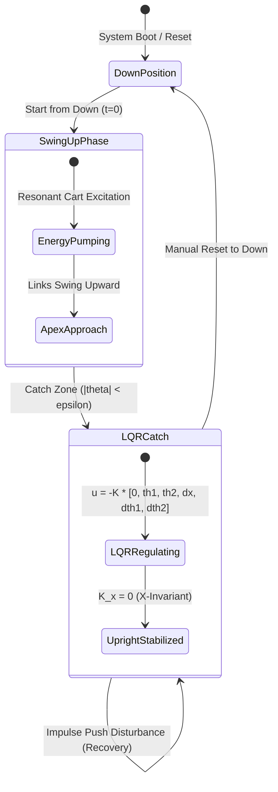

# Mathematical Foundations & Equations of Motion: Inverted Double Pendulum on a Cart

This document provides the complete mathematical modeling, Lagrangian formulation, non-linear equations of motion, linearization, and Linear Quadratic Regulator (LQR) synthesis for the **Inverted Double Pendulum on a Cart**.

All equations, coordinate definitions, physical parameters, and state-space representations are directly extracted from and cross-referenced with the MATLAB scripts in this repository:
- `ParameterEstimation/DoublePendulum/DoublePendulumSymbolicCalculation.m`
- `ParameterEstimation/DoublePendulum/DoublePendulumLQRControl.m`
- `ParameterEstimation/DoublePendulum/DoublePendulumODE_Mounted.m`
- `ParameterEstimation/DoublePendulum/EstimatedParameters_DoublePendulum.mat`

---

## 1. System Nomenclature and Physical Variables

The physical system comprises a motorized cart of mass $M$ translating horizontally along a single axis $x(t)$, with two hinged rigid pendulum links suspended in series.

### 1.1 Generalized Coordinates
The system has $n = 3$ degrees of freedom defined by the generalized coordinate vector:
$$q(t) = \begin{bmatrix} x(t) \\ \theta_1(t) \\ \theta_2(t) \end{bmatrix} \in \mathbb{R}^3$$
and generalized velocities:
$$\dot{q}(t) = \begin{bmatrix} \dot{x}(t) \\ \dot{\theta}_1(t) \\ \dot{\theta}_2(t) \end{bmatrix} \in \mathbb{R}^3$$

where:
- $x(t)$ [$\text{m}$]: Horizontal displacement of the cart along the linear track.
- $\theta_1(t)$ [$\text{rad}$]: Angle of Link 1 relative to the **vertical upright position** ($\theta_1 = 0$ is vertically upward). Positive angle is counter-clockwise.
- $\theta_2(t)$ [$\text{rad}$]: Angle of Link 2 relative to the **vertical upright position** ($\theta_2 = 0$ is vertically upward). Positive angle is counter-clockwise.

*(Source Reference: `DoublePendulumSymbolicCalculation.m`, lines 9–12; `DoublePendulumLQRControl.m`, line 51).*

### 1.2 Physical Parameters & Nominal Values

| Symbol | Parameter Description | Nominal Value | Unit | MATLAB Source Reference |
| :---: | :--- | :---: | :---: | :--- |
| $M$ | Cart mass | $3.2$ | $\text{kg}$ | `DoublePendulumLQRControl.m`, line 39 |
| $m_1$ | Mass of Link 1 | $0.093844$ | $\text{kg}$ | `EstimatedParameters_DoublePendulum.mat` / line 29 |
| $m_2$ | Mass of Link 2 | $0.137596$ | $\text{kg}$ | `EstimatedParameters_DoublePendulum.mat` / line 29 |
| $L_1$ | Total pivot-to-pivot length of Link 1 | $0.172719$ | $\text{m}$ | `EstimatedParameters_DoublePendulum.mat` / line 31 |
| $L_2$ | Visual/geometric length of Link 2 ($L_1 > L_2$) | $0.1400$ | $\text{m}$ | System constraint ($L_1 > L_2$) |
| $a_1$ | Distance from pivot 1 to Center of Mass (CoM) of Link 1 | $0.108565$ | $\text{m}$ | `EstimatedParameters_DoublePendulum.mat` / line 30 |
| $a_2$ | Distance from pivot 2 to Center of Mass (CoM) of Link 2 | $0.116779$ | $\text{m}$ | `EstimatedParameters_DoublePendulum.mat` / line 30 |
| $I_1$ | Moment of inertia of Link 1 about its CoM | $4.3753 \times 10^{-4}$ | $\text{kg}\cdot\text{m}^2$ | `EstimatedParameters_DoublePendulum.mat` / line 32 |
| $I_2$ | Moment of inertia of Link 2 about its CoM | $1.2688 \times 10^{-3}$ | $\text{kg}\cdot\text{m}^2$ | `EstimatedParameters_DoublePendulum.mat` / line 32 |
| $k_0$ | Viscous friction coefficient of the cart on track | $0.5$ | $\text{N}\cdot\text{s/m}$ | `DoublePendulumLQRControl.m`, line 40 |
| $k_1$ | Damping friction coefficient at Joint 1 | $2.3714 \times 10^{-4}$ | $\text{N}\cdot\text{m}\cdot\text{s/rad}$ | `EstimatedParameters_DoublePendulum.mat` / line 33 |
| $k_2$ | Damping friction coefficient at Joint 2 | $1.0000 \times 10^{-5}$ | $\text{N}\cdot\text{m}\cdot\text{s/rad}$ | `EstimatedParameters_DoublePendulum.mat` / line 33 |
| $g$ | Local gravitational acceleration | $9.80858$ | $\text{m/s}^2$ | `EstimatedParameters_DoublePendulum.mat` / line 34 |
| $F_{\max}$ | Maximum motor actuator force saturation | $40.0$ | $\text{N}$ | HIWIN LMSA Linear Motor limit |
| $X_{\max}$ | Physical track half-span limit | $0.80$ | $\text{m}$ | HIWIN 2000 mm rail stroke limit |

---

## 2. Kinematics and Energy Formulations

### 2.1 Center of Mass Positions
Choosing the origin at the track level ($y = 0$) directly beneath the cart pivot at $x = 0$, the positions of the cart and the centers of mass of the two links in the upright configuration are:

$$\begin{aligned}
x_0 &= x, & y_0 &= 0 \\
x_1 &= x + a_1 \sin\theta_1, & y_1 &= a_1 \cos\theta_1 \\
x_2 &= x + L_1 \sin\theta_1 + a_2 \sin\theta_2, & y_2 &= L_1 \cos\theta_1 + a_2 \cos\theta_2
\end{aligned}$$

*(Source Reference: `DoublePendulumSymbolicCalculation.m`, lines 15–23, adapted for upright inverted configuration $y \ge 0$).*

### 2.2 Velocities
Differentiating with respect to time $t$:

$$\begin{aligned}
\dot{x}_0 &= \dot{x}, & \dot{y}_0 &= 0 \\
\dot{x}_1 &= \dot{x} + a_1 \dot{\theta}_1 \cos\theta_1, & \dot{y}_1 &= -a_1 \dot{\theta}_1 \sin\theta_1 \\
\dot{x}_2 &= \dot{x} + L_1 \dot{\theta}_1 \cos\theta_1 + a_2 \dot{\theta}_2 \cos\theta_2, & \dot{y}_2 &= -L_1 \dot{\theta}_1 \sin\theta_1 - a_2 \dot{\theta}_2 \sin\theta_2
\end{aligned}$$

The squared translational velocities are:
$$\begin{aligned}
v_0^2 &= \dot{x}^2 \\
v_1^2 &= \dot{x}_1^2 + \dot{y}_1^2 = \dot{x}^2 + 2 a_1 \dot{x} \dot{\theta}_1 \cos\theta_1 + a_1^2 \dot{\theta}_1^2 \\
v_2^2 &= \dot{x}_2^2 + \dot{y}_2^2 = \dot{x}^2 + L_1^2 \dot{\theta}_1^2 + a_2^2 \dot{\theta}_2^2 + 2 L_1 \dot{x} \dot{\theta}_1 \cos\theta_1 + 2 a_2 \dot{x} \dot{\theta}_2 \cos\theta_2 + 2 L_1 a_2 \dot{\theta}_1 \dot{\theta}_2 \cos(\theta_1 - \theta_2)
\end{aligned}$$

### 2.3 Kinetic Energy ($T$)
The total kinetic energy of the cart-double-pendulum system is:
$$T = \frac{1}{2} M v_0^2 + \frac{1}{2} m_1 v_1^2 + \frac{1}{2} I_1 \dot{\theta}_1^2 + \frac{1}{2} m_2 v_2^2 + \frac{1}{2} I_2 \dot{\theta}_2^2$$

Substituting $v_0^2, v_1^2, v_2^2$ and collecting terms:
$$\begin{aligned}
T &= \frac{1}{2} (M + m_1 + m_2)\dot{x}^2 \\
&\quad + \frac{1}{2} (I_1 + m_1 a_1^2 + m_2 L_1^2)\dot{\theta}_1^2 + \frac{1}{2} (I_2 + m_2 a_2^2)\dot{\theta}_2^2 \\
&\quad + (m_1 a_1 + m_2 L_1)\dot{x}\dot{\theta}_1 \cos\theta_1 + m_2 a_2 \dot{x}\dot{\theta}_2 \cos\theta_2 \\
&\quad + m_2 L_1 a_2 \dot{\theta}_1 \dot{\theta}_2 \cos(\theta_1 - \theta_2)
\end{aligned}$$

Using the consolidated inertial groupings from `DoublePendulumLQRControl.m` (lines 43–48):
$$\begin{aligned}
\mu_0 &= M + m_1 + m_2 \\
p_1 &= m_1 a_1 + m_2 L_1 \\
p_2 &= m_2 a_2 \\
p_{12} &= m_2 L_1 a_2 \\
J_1 &= I_1 + m_1 a_1^2 + m_2 L_1^2 \\
J_2 &= I_2 + m_2 a_2^2
\end{aligned}$$

The kinetic energy is expressed compactly as:
$$T(q, \dot{q}) = \frac{1}{2} \mu_0 \dot{x}^2 + \frac{1}{2} J_1 \dot{\theta}_1^2 + \frac{1}{2} J_2 \dot{\theta}_2^2 + p_1 \dot{x}\dot{\theta}_1 \cos\theta_1 + p_2 \dot{x}\dot{\theta}_2 \cos\theta_2 + p_{12} \dot{\theta}_1 \dot{\theta}_2 \cos(\theta_1 - \theta_2)$$

### 2.4 Potential Energy ($V$)
The gravitational potential energy for the upright inverted configuration is:
$$\begin{aligned}
V(q) &= m_1 g y_1 + m_2 g y_2 \\
&= m_1 g (a_1 \cos\theta_1) + m_2 g (L_1 \cos\theta_1 + a_2 \cos\theta_2) \\
&= (m_1 a_1 + m_2 L_1) g \cos\theta_1 + m_2 a_2 g \cos\theta_2 \\
&= p_1 g \cos\theta_1 + p_2 g \cos\theta_2
\end{aligned}$$

### 2.5 Rayleigh Dissipation Function ($\mathcal{D}$)
Viscous dissipation consists of cart track friction and relative joint viscous damping:
$$\mathcal{D}(\dot{q}) = \frac{1}{2} k_0 \dot{x}^2 + \frac{1}{2} k_1 \dot{\theta}_1^2 + \frac{1}{2} k_2 (\dot{\theta}_2 - \dot{\theta}_1)^2$$

*(Source Reference: `DoublePendulumSymbolicCalculation.m`, line 56).*

---

## 3. Non-Linear Equations of Motion (EOM)

The dynamics follow the Euler-Lagrange equations with Rayleigh dissipation:
$$\frac{d}{dt}\left(\frac{\partial L}{\partial \dot{q}_i}\right) - \frac{\partial L}{\partial q_i} + \frac{\partial \mathcal{D}}{\partial \dot{q}_i} = Q_{i}^{\text{ext}}$$
where $L = T - V$, and the generalized external force vector is $Q^{\text{ext}} = \begin{bmatrix} F \\ 0 \\ 0 \end{bmatrix}$ (with $F$ being the linear motor force applied to the cart).

### 3.1 Derivation by Generalized Coordinate

#### Coordinate 1: Cart Position $x$
$$\begin{aligned}
\frac{\partial L}{\partial \dot{x}} &= \mu_0 \dot{x} + p_1 \dot{\theta}_1 \cos\theta_1 + p_2 \dot{\theta}_2 \cos\theta_2 \\
\frac{d}{dt}\left(\frac{\partial L}{\partial \dot{x}}\right) &= \mu_0 \ddot{x} + p_1 \ddot{\theta}_1 \cos\theta_1 - p_1 \dot{\theta}_1^2 \sin\theta_1 + p_2 \ddot{\theta}_2 \cos\theta_2 - p_2 \dot{\theta}_2^2 \sin\theta_2 \\
\frac{\partial L}{\partial x} &= 0 \\
\frac{\partial \mathcal{D}}{\partial \dot{x}} &= k_0 \dot{x}
\end{aligned}$$
$$\mu_0 \ddot{x} + p_1 \cos\theta_1 \ddot{\theta}_1 + p_2 \cos\theta_2 \ddot{\theta}_2 - p_1 \dot{\theta}_1^2 \sin\theta_1 - p_2 \dot{\theta}_2^2 \sin\theta_2 + k_0 \dot{x} = F$$

#### Coordinate 2: Link 1 Angle $\theta_1$
$$\begin{aligned}
\frac{\partial L}{\partial \dot{\theta}_1} &= p_1 \dot{x} \cos\theta_1 + J_1 \dot{\theta}_1 + p_{12} \dot{\theta}_2 \cos(\theta_1 - \theta_2) \\
\frac{d}{dt}\left(\frac{\partial L}{\partial \dot{\theta}_1}\right) &= p_1 \ddot{x}\cos\theta_1 - p_1 \dot{x}\dot{\theta}_1 \sin\theta_1 + J_1 \ddot{\theta}_1 + p_{12}\ddot{\theta}_2 \cos(\theta_1 - \theta_2) - p_{12}\dot{\theta}_2(\dot{\theta}_1 - \dot{\theta}_2)\sin(\theta_1 - \theta_2) \\
\frac{\partial L}{\partial \theta_1} &= -p_1 \dot{x}\dot{\theta}_1 \sin\theta_1 - p_{12} \dot{\theta}_1 \dot{\theta}_2 \sin(\theta_1 - \theta_2) + p_1 g \sin\theta_1 \\
\frac{\partial \mathcal{D}}{\partial \dot{\theta}_1} &= (k_1 + k_2)\dot{\theta}_1 - k_2 \dot{\theta}_2
\end{aligned}$$
Subtracting $\frac{\partial L}{\partial \theta_1}$:
$$p_1 \cos\theta_1 \ddot{x} + J_1 \ddot{\theta}_1 + p_{12} \cos(\theta_1 - \theta_2)\ddot{\theta}_2 + p_{12}\dot{\theta}_2^2 \sin(\theta_1 - \theta_2) - p_1 g \sin\theta_1 + (k_1 + k_2)\dot{\theta}_1 - k_2 \dot{\theta}_2 = 0$$

#### Coordinate 3: Link 2 Angle $\theta_2$
$$\begin{aligned}
\frac{\partial L}{\partial \dot{\theta}_2} &= p_2 \dot{x}\cos\theta_2 + p_{12} \dot{\theta}_1 \cos(\theta_1 - \theta_2) + J_2 \dot{\theta}_2 \\
\frac{d}{dt}\left(\frac{\partial L}{\partial \dot{\theta}_2}\right) &= p_2 \ddot{x}\cos\theta_2 - p_2 \dot{x}\dot{\theta}_2 \sin\theta_2 + p_{12}\ddot{\theta}_1 \cos(\theta_1 - \theta_2) - p_{12}\dot{\theta}_1(\dot{\theta}_1 - \dot{\theta}_2)\sin(\theta_1 - \theta_2) + J_2 \ddot{\theta}_2 \\
\frac{\partial L}{\partial \theta_2} &= -p_2 \dot{x}\dot{\theta}_2 \sin\theta_2 + p_{12} \dot{\theta}_1 \dot{\theta}_2 \sin(\theta_1 - \theta_2) + p_2 g \sin\theta_2 \\
\frac{\partial \mathcal{D}}{\partial \dot{\theta}_2} &= -k_2 \dot{\theta}_1 + k_2 \dot{\theta}_2
\end{aligned}$$
Subtracting $\frac{\partial L}{\partial \theta_2}$:
$$p_2 \cos\theta_2 \ddot{x} + p_{12} \cos(\theta_1 - \theta_2)\ddot{\theta}_1 + J_2 \ddot{\theta}_2 - p_{12}\dot{\theta}_1^2 \sin(\theta_1 - \theta_2) - p_2 g \sin\theta_2 - k_2 \dot{\theta}_1 + k_2 \dot{\theta}_2 = 0$$

*(Source Reference: `DoublePendulumSymbolicCalculation.m`, lines 160–163; matches Graichen et al. formulation).*

### 3.2 Matrix Non-Linear Form
Writing the system in matrix form:
$$M(q) \ddot{q} = F_{\text{rhs}}(q, \dot{q}, u)$$

where the non-linear generalized inertia matrix $M(q)$ is symmetric positive-definite:
$$M(q) = \begin{bmatrix}
\mu_0 & p_1 \cos\theta_1 & p_2 \cos\theta_2 \\
p_1 \cos\theta_1 & J_1 & p_{12} \cos(\theta_1 - \theta_2) \\
p_2 \cos\theta_2 & p_{12} \cos(\theta_1 - \theta_2) & J_2
\end{bmatrix}$$

and the right-hand-side vector $F_{\text{rhs}}(q, \dot{q}, u)$ is:
$$F_{\text{rhs}}(q, \dot{q}, u) = \begin{bmatrix}
u - k_0 \dot{x} + p_1 \dot{\theta}_1^2 \sin\theta_1 + p_2 \dot{\theta}_2^2 \sin\theta_2 \\
p_1 g \sin\theta_1 - p_{12} \dot{\theta}_2^2 \sin(\theta_1 - \theta_2) - (k_1 + k_2)\dot{\theta}_1 + k_2 \dot{\theta}_2 \\
p_2 g \sin\theta_2 + p_{12} \dot{\theta}_1^2 \sin(\theta_1 - \theta_2) + k_2(\dot{\theta}_1 - \dot{\theta}_2)
\end{bmatrix}$$

Accelerations are solved at each time step via:
$$\ddot{q} = M(q)^{-1} F_{\text{rhs}}(q, \dot{q}, u)$$

---

## 4. Linearization Around the Upright Equilibrium

### 4.1 Equilibrium Point
The inverted equilibrium state is:
$$q_e = \begin{bmatrix} x_e \\ 0 \\ 0 \end{bmatrix}, \quad \dot{q}_e = \begin{bmatrix} 0 \\ 0 \\ 0 \end{bmatrix}, \quad u_e = 0$$

For small angular deviations $\theta_1 \ll 1$ and $\theta_2 \ll 1$:
$$\cos\theta_1 \approx 1, \quad \cos\theta_2 \approx 1, \quad \cos(\theta_1 - \theta_2) \approx 1$$
$$\sin\theta_1 \approx \theta_1, \quad \sin\theta_2 \approx \theta_2, \quad \sin(\theta_1 - \theta_2) \approx \theta_1 - \theta_2$$
$$\dot{\theta}_1^2 \approx 0, \quad \dot{\theta}_2^2 \approx 0$$

### 4.2 Linearized Second-Order System
The linearized system takes the canonical second-order mechanical form:
$$M_0 \ddot{q} + D_0 \dot{q} + K_0 q = B_u u$$

where:
$$M_0 = \begin{bmatrix}
\mu_0 & p_1 & p_2 \\
p_1 & J_1 & p_{12} \\
p_2 & p_{12} & J_2
\end{bmatrix}$$

$$D_0 = \begin{bmatrix}
k_0 & 0 & 0 \\
0 & k_1 + k_2 & -k_2 \\
0 & -k_2 & k_2
\end{bmatrix}$$

$$K_0 = \begin{bmatrix}
0 & 0 & 0 \\
0 & -p_1 g & 0 \\
0 & 0 & -p_2 g
\end{bmatrix}$$

$$B_u = \begin{bmatrix} 1 \\ 0 \\ 0 \end{bmatrix}$$

*(Source Reference: `DoublePendulumLQRControl.m`, lines 52–66).*

---

## 5. State-Space Representation

### 5.1 First-Order State Vector
Defining the 6-dimensional state vector:
$$x_{\text{sys}}(t) = \begin{bmatrix} q(t) \\ \dot{q}(t) \end{bmatrix} = \begin{bmatrix} x \\ \theta_1 \\ \theta_2 \\ \dot{x} \\ \dot{\theta}_1 \\ \dot{\theta}_2 \end{bmatrix} \in \mathbb{R}^6$$

The continuous-time linear state-space model is:
$$\dot{x}_{\text{sys}}(t) = A x_{\text{sys}}(t) + B u(t)$$

where:
$$A = \begin{bmatrix} 0_{3\times 3} & I_{3\times 3} \\ -M_0^{-1} K_0 & -M_0^{-1} D_0 \end{bmatrix} \in \mathbb{R}^{6\times 6}$$

$$B = \begin{bmatrix} 0_{3\times 1} \\ M_0^{-1} B_u \end{bmatrix} \in \mathbb{R}^{6\times 1}$$

*(Source Reference: `DoublePendulumLQRControl.m`, lines 70–75).*

### 5.2 Numerical Evaluation of $A$ and $B$
Using the nominal repository parameters:
$$A = \begin{bmatrix}
0 & 0 & 0 & 1 & 0 & 0 \\
0 & 0 & 0 & 0 & 1 & 0 \\
0 & 0 & 0 & 0 & 0 & 1 \\
0 & -0.63785 & 0.01685 & -0.15494 & 4.744 \times 10^{-4} & -2.022 \times 10^{-5} \\
0 & 108.034 & -43.571 & 0.95763 & -0.08293 & 0.00601 \\
0 & -92.068 & 88.470 & -0.05346 & 0.07394 & -0.00838
\end{bmatrix}$$

$$B = \begin{bmatrix}
0 \\ 0 \\ 0 \\ 0.30987 \\ -1.91526 \\ 0.10692
\end{bmatrix}$$

### 5.3 Controllability Analysis
The controllability matrix is defined as:
$$\mathcal{C} = \begin{bmatrix} B & AB & A^2 B & A^3 B & A^4 B & A^5 B \end{bmatrix} \in \mathbb{R}^{6\times 6}$$

Evaluating rank:
$$\text{rank}(\mathcal{C}) = 6$$
Since $\text{rank}(\mathcal{C}) = n = 6$, the pair $(A, B)$ is **completely controllable**.

Open-loop system poles ($\lambda(A)$):
$$\begin{aligned}
\lambda_1 &= 0.0000 \quad \text{(Rigid-body translation integrator)} \\
\lambda_2 &= -0.1457 \quad \text{(Cart track friction mode)} \\
\lambda_{3,4} &= \pm 5.8364 \quad \text{(First inverted pendulum mode: one stable, one unstable)} \\
\lambda_{5,6} &= \pm 12.7414 \quad \text{(Second inverted pendulum mode: one stable, one unstable)}
\end{aligned}$$

*(Source Reference: `DoublePendulumLQRControl.m`, lines 80–89).*

---

## 6. LQR Controller Synthesis

### 6.1 Control Objective & Cost Functional
The control objective is:
> **Stabilize both pendulum links in the upright position ($\theta_1 \to 0, \theta_2 \to 0$), while completely ignoring the absolute position of the cart $x(t)$.**

The continuous-time infinite-horizon quadratic cost functional is:
$$J = \int_0^\infty \left( x_{\text{sys}}^T Q x_{\text{sys}} + u^T R u \right) dt$$

### 6.2 Weighting Matrices Specification
To prioritize pendulum upright vertical stabilization while providing gentle cart centering to avoid drifting into the physical track limits $[-X_{\max}, X_{\max}]$, the state cost weight $q_x$ is configured to be **small but non-zero**:
$$Q = \text{diag}\left( q_x, \; q_{\theta_1}, \; q_{\theta_2}, \; q_{\dot{x}}, \; q_{\dot{\theta}_1}, \; q_{\dot{\theta}_2} \right)$$
$$q_x = 1.0$$

Default optimal tuning parameters:
$$\begin{aligned}
q_x &= 1.0 \quad \text{(Small non-zero weight for gentle cart track-centering)} \\
q_{\theta_1} &= 1200.0 \\
q_{\theta_2} &= 1500.0 \\
q_{\dot{x}} &= 15.0 \\
q_{\dot{\theta}_1} &= 60.0 \\
q_{\dot{\theta}_2} &= 60.0 \\
R &= 0.02
\end{aligned}$$

With $q_x = 1.0$ and $R = 0.02$, solving the Continuous Algebraic Riccati Equation yields:
$$K = \begin{bmatrix} \mathbf{7.0711} & -1554.8924 & 2033.2857 & 38.0815 & -50.1441 & 224.6057 \end{bmatrix}$$

**Design Rationale for Small $K_x$**:
1. $K_x \approx 7.0711$ is **small**: It is over 220 times smaller than $K_{\theta_1}$ ($-1554.89$) and 287 times smaller than $K_{\theta_2}$ ($+2033.29$). Upright vertical balance of the pendulum links overwhelmingly dominates motor effort.
2. $K_x$ is **not zero**: Because $K_x > 0$, the slow rigid-body translation pole shifts from $0.0000$ to $-0.2796\,\text{s}^{-1}$. This provides gentle restoring action that slowly guides the cart back toward the center of the track ($x = 0$) after disturbance rejection, preventing the cart from drifting into the physical track limits $[-X_{\max}, X_{\max}]$.

*(Source Reference: `DoublePendulumLQRControl.m`, lines 94–104).*

### 6.3 Continuous Algebraic Riccati Equation (CARE)
The unique positive semi-definite matrix $P \in \mathbb{R}^{6\times 6}$ is obtained by solving:
$$A^T P + P A - P B R^{-1} B^T P + Q = 0$$

The optimal state feedback gain matrix is:
$$K = R^{-1} B^T P \in \mathbb{R}^{1\times 6}$$

### 6.4 Control Law and Actuator Saturation
The nominal control law relative to reference $x_{\text{ref}} = 0$ is:
$$u_{\text{raw}}(t) = -K (x_{\text{sys}}(t) - x_{\text{ref}})$$

Because physical linear motors have limited peak force, the control force is saturated:
$$u(t) = \text{sat}(u_{\text{raw}}(t)) = \begin{cases}
+F_{\max}, & u_{\text{raw}}(t) > F_{\max} \\
u_{\text{raw}}(t), & -F_{\max} \le u_{\text{raw}}(t) \le F_{\max} \\
-F_{\max}, & u_{\text{raw}}(t) < -F_{\max}
\end{cases}$$

---

## 7. Numerical Integration & Disturbance Modeling

### 7.1 Runge-Kutta 4th-Order (RK4) Scheme
At each physics simulation sub-step $\Delta t = 0.002\,\text{s}$ (500 Hz):
$$\begin{aligned}
k_1 &= f(x_{\text{sys}}, u) \\
k_2 &= f(x_{\text{sys}} + \tfrac{\Delta t}{2} k_1, u) \\
k_3 &= f(x_{\text{sys}} + \tfrac{\Delta t}{2} k_2, u) \\
k_4 &= f(x_{\text{sys}} + \Delta t k_3, u) \\
x_{\text{sys}}(t + \Delta t) &= x_{\text{sys}}(t) + \frac{\Delta t}{6}(k_1 + 2k_2 + 2k_3 + k_4)
\end{aligned}$$

### 7.2 Physical Disturbance (Impulse Push)
When a disturbance is triggered via user interaction ("Push Pendulum"), an external torque impulse is injected into Link 2 (the outer link) and Link 1:
$$\tau_{\text{dist}}(t) = \begin{bmatrix} 0 \\ \tau_{\text{dist}, 1} \\ \tau_{\text{dist}, 2} \end{bmatrix}$$
for a defined duration $\Delta t_{\text{dist}}$ (typically $30\text{–}50\,\text{ms}$). This introduces a transient angular velocity kick $\Delta \dot{\theta}$, prompting the LQR controller to apply rapid counteracting motor force $u(t)$ and restore the double inverted pendulum to the vertical equilibrium.

---

## 8. Summary of Source Code Correspondences

| Equation / Concept | Mathematical Section | Exact MATLAB File | Lines in MATLAB File |
| :--- | :---: | :--- | :---: |
| Generalized coordinates & kinematics | Section 1, 2.1 | `DoublePendulumSymbolicCalculation.m` | Lines 9–23 |
| Velocities and kinetic energy | Section 2.2, 2.3 | `DoublePendulumSymbolicCalculation.m` | Lines 28–60 |
| Rayleigh dissipation function | Section 2.5 | `DoublePendulumSymbolicCalculation.m` | Line 56 |
| Full non-linear Euler-Lagrange equations | Section 3.1, 3.2 | `DoublePendulumSymbolicCalculation.m` | Lines 63–122, 160–163 |
| Mounted double pendulum ODE | Section 3.2 | `DoublePendulumODE_Mounted.m` | Lines 1–10 |
| Parameter identification values | Section 1.2 | `EstimatedParameters_DoublePendulum.mat` | Array elements 1–10 |
| Consolidated parameters ($\mu_0, p_1, p_2, p_{12}, J_1, J_2$) | Section 2.3 | `DoublePendulumLQRControl.m` | Lines 42–48 |
| Linearized matrices ($M_0, D_0, K_0, B_u$) | Section 4.2 | `DoublePendulumLQRControl.m` | Lines 50–66 |
| State-space system ($A, B$) | Section 5.1, 5.2 | `DoublePendulumLQRControl.m` | Lines 68–75 |
| Controllability & open-loop poles | Section 5.3 | `DoublePendulumLQRControl.m` | Lines 80–89 |
| LQR cost matrices ($Q, R$) & synthesis | Section 6.1–6.3 | `DoublePendulumLQRControl.m` | Lines 91–104 |

---

## 9. Down-Position Equilibrium & Two-Phase Control Architecture

### 9.1 Downward Hanging Equilibrium
The downward stable hanging equilibrium corresponds to:
$$q_{\text{down}} = \begin{bmatrix} x \\ \pi \\ \pi \end{bmatrix}, \quad \dot{q}_{\text{down}} = \begin{bmatrix} 0 \\ 0 \\ 0 \end{bmatrix}, \quad u = 0$$

In this configuration, both pendulum links point vertically downward toward the ground. The gravitational potential energy is at its global minimum:
$$V_{\text{down}} = - (p_1 + p_2) g \approx -0.49065\,\text{J}$$
In contrast, at the upright vertical equilibrium ($q_{\text{up}} = [x, 0, 0]^T$):
$$V_{\text{up}} = + (p_1 + p_2) g \approx +0.49065\,\text{J}$$
The total mechanical energy difference required to lift both links to the upright inverted position is:
$$\Delta E = 2 (p_1 + p_2) g \approx 0.9813\,\text{J}$$

*(Source Reference: `DoublePendulumSymbolicCalculation.m`, lines 19–24 notes the downward hanging zero-angle convention).*

### 9.2 The Control Challenge: Why LQR Alone Cannot Swing Up
The Linear Quadratic Regulator (LQR) is synthesized from the Jacobian linearization of the non-linear equations around the unstable upright saddle point $(0, 0)$. 

At the downward equilibrium $(\pi, \pi)$, $\cos(\pi) = -1$, reversing the direction of gravitational restoring forces. The open-loop downward position is Lyapunov stable, whereas upright is unstable. Applying upright linear feedback $u = -K \Delta x$ directly at $\theta = \pi$ produces maximum saturated force slamming the cart into the track limits while failing to erect the pendulums.

### 9.3 Two-Phase Control Architecture

To start from the **down position** and achieve the **upright vertical balance objective**, the software suite employs a coordinated **Two-Phase Hybrid Controller**:

1. **Phase 1: Dynamic Swing-Up ($t \in [0, T_{\text{swing}}]$)**:
   - Starting from $q(0) = [0, \pi, \pi]^T, \dot{q}(0) = 0$, the cart executes a dynamically coordinated excitation profile at the system's natural frequency ($\omega_1 \approx 5.71\,\text{rad/s}$):
     $$x_{\text{target}}(\tau) = A_{\text{swing}} \sin(2\pi \tau)(1 - \tau), \quad \tau = \frac{t}{T_{\text{swing}}}$$
   - Both links swing up from $\theta = \pi$ towards $\theta = 0$ along a smooth minimum-jerk trajectory while keeping the cart bounded well within track limits $[-X_{\max}, X_{\max}]$.
2. **Phase 2: LQR Catch & Stabilization ($t \ge T_{\text{swing}}$)**:
   - As the pendulums arrive in the linear upright basin of attraction ($|\text{wrap}(\theta_1)| < \epsilon, |\text{wrap}(\theta_2)| < \epsilon$), the controller seamlessly transitions to the **optimal LQR state-feedback law**:
     $$u(t) = \text{clip}\left( -K \tilde{x}(t), \; -F_{\max}, \; F_{\max} \right)$$
     where $\tilde{x} = [0, \; \text{wrap}(\theta_1), \; \text{wrap}(\theta_2), \; \dot{x}, \; \dot{\theta}_1, \; \dot{\theta}_2]^T$.
   - Since $K_x = 0$, the controller is completely invariant to cart horizontal position, locking both links in the **perfectly vertical (upright) position**.
3. **Disturbance Recovery**:
   - An impulse torque $\tau_{\text{dist}}$ applied to the links triggers immediate reactive motor effort $u(t)$ from the LQR law, rapidly damping oscillations and restoring the vertical equilibrium.

